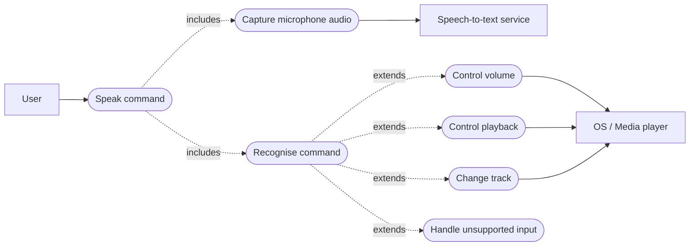

# Software Requirements Specification

**Project:** Voice Assistant for Multimedia Controls  
**Version:** 1.1-validation
**Date:** 19 November 2026
**Status:** Implemented; automated validation complete; physical system validation pending
**Authors:** SE_MINIPROJECT team

## Revision history

| Version | Date | Change summary |
| --- | --- | --- |
| 1.0-draft | 12 October 2026 | Initial SRS for the mini-project |
| 1.1-validation | 19 November 2026 | Updated implementation, traceability, platform boundaries, and validation evidence |

## 1. Introduction

### 1.1 Purpose

This SRS defines the functional, quality, interface, and security requirements for a Python voice assistant that controls multimedia playback on a laptop or supported media device.

### 1.2 Scope

The product receives one spoken command through a microphone, converts it to text, identifies a supported intent, and requests the matching media action. The first release supports volume up/down, play, pause, resume, next track, and previous track. Unsupported or unrecognised speech is handled without terminating the application.

The first release excludes user accounts, playlists, a graphical interface, cloud storage, and media-player implementation internals.

### 1.3 Audience

This document is for the project team, test reviewers, course instructor, and future maintainers.

### 1.4 Definitions

| Term | Meaning |
| --- | --- |
| STT | Speech-to-text conversion of microphone audio into text using an external service. |
| Media backend | Adapter that sends an action to the operating system or media player. |
| Command | A recognised supported intent, represented by the `Command` enum. |
| RTM | Requirements Traceability Matrix. |

## 2. Overall description

### 2.1 Product perspective

The system is a small layered application. A voice-input component supplies text, a command parser maps text to a command, a dispatcher selects a feature module, and feature modules call a media backend through the shared `MediaController` interface.

### 2.2 User class

The primary user is a laptop or device user who needs hands-free basic media control. The user is expected to speak one short English command at a time.

### 2.3 Operating environment

Python 3.12 or 3.14 runs on Windows or a Linux desktop with a microphone, internet access when a cloud STT provider is used, and a supported media-control mechanism. Unit tests must run without microphone hardware.

### 2.4 Constraints and assumptions

- Commands are English phrases from the supported-command list.
- The host OS/media player must expose controls that the selected backend can invoke.
- Audio recognition may be unavailable because of silence, no microphone, or network/service failure.
- The application does not intentionally persist audio or transcripts. Audio is sent to Google for recognition; third-party processing is outside the local-retention guarantee.

## 3. External interface requirements

### 3.1 User interface

Version 1 uses a command-line interface. It shall show a concise outcome message after each captured command, such as `Playback paused` or `Unsupported command`.

### 3.2 Hardware interface

The voice-input component shall use the host’s default microphone through a microphone library. The application shall still be testable through injected fake microphone and recognizer objects.

### 3.3 Software interfaces

| Interface | Purpose |
| --- | --- |
| Speech-recognition provider | Converts a captured phrase to text. |
| `MediaController` | Abstract API used by feature modules to request volume, playback, and track actions. |
| OS/media-player adapter | Concrete implementation of `MediaController`; platform-specific and replaceable. |

## 4. System features and functional requirements

Priority meanings: **High** is required for the first working release; **Medium** improves robustness or usability.

| ID | Requirement | Priority | Acceptance criterion |
| --- | --- | --- | --- |
| FR-01 | The system shall open the configured microphone and capture one spoken phrase. | High | A valid fake or physical microphone produces one audio input attempt. |
| FR-02 | The system shall send captured audio to the configured STT recognizer and obtain text when recognition succeeds. | High | A recognizer result `Volume Up` is returned as text. |
| FR-03 | The system shall stop waiting for speech after a configurable positive timeout. | High | A timeout returns control to the application without an uncaught exception. |
| FR-04 | The system shall return no command when audio is silent, unintelligible, blank, or the STT service is unavailable. | High | Each condition yields a safe outcome and the process remains running. |
| FR-05 | The system shall normalise recognised text by ignoring case, punctuation, and repeated whitespace. | High | `  Volume Up! ` maps to `VOLUME_UP`. |
| FR-06 | The system shall recognise `Volume Up` and `Increase Volume`. | High | Either phrase dispatches one volume-increase request by default (steps are configurable). |
| FR-07 | The system shall recognise `Volume Down` and `Decrease Volume`. | High | Either phrase dispatches one volume-decrease request by default (steps are configurable). |
| FR-08 | The system shall recognise `Play`. | High | The backend receives exactly one `play()` request. |
| FR-09 | The system shall recognise `Pause`. | High | The backend receives exactly one `pause()` request. |
| FR-10 | The system shall recognise `Resume`. | High | The backend receives exactly one `resume()` request. |
| FR-11 | The system shall recognise `Next` and `Next Track`. | High | Either phrase dispatches one `next_track()` request. |
| FR-12 | The system shall recognise `Previous` and `Previous Track`. | High | Either phrase dispatches one `previous_track()` request. |
| FR-13 | The system shall display a simple safe message and make no backend request for an unsupported command. | High | `dance` reports unsupported input without an exception. |
| FR-14 | The dispatcher shall route each recognised command to exactly one matching feature operation. | High | A parameterised integration test verifies one route per command. |
| FR-15 | The system shall display a clear failure message and remain available when a backend action fails. | Medium | A backend exception produces a failure message and a later command can be handled. |

## 5. Non-functional requirements

| ID | Requirement | Measure / acceptance criterion |
| --- | --- | --- |
| NFR-01 | The command-processing path after text recognition shall complete within 2 seconds for 95% of 100 test runs on the target laptop. | Timed automated test or recorded test report. |
| NFR-02 | The application shall recover from an unsupported command, recognition failure, or backend exception without process termination. | 100% of applicable resilience tests pass. |
| NFR-03 | Each feature module shall depend on the `MediaController` interface rather than direct OS-specific calls. | Code review finds no OS media call outside the backend module. |
| NFR-04 | The project shall provide automated tests for every FR and run them in GitHub Actions on pull requests. | CI succeeds; RTM has a test reference for every FR. |
| NFR-05 | The source shall pass configured static-analysis and security checks with no high-severity findings. | `flake8` and `bandit` return success in CI. |
| NFR-06 | The user-facing result of a handled command shall be concise and understandable. | Manual review confirms outcome or failure message for every command. |

### 5.1 Security objectives

| ID | Objective |
| --- | --- |
| SO-01 | Protect user privacy by minimising audio/data retention and avoiding sensitive data in logs. |
| SO-02 | Preserve control integrity so malformed input or a failed external service cannot trigger an unintended media action or crash the application. |

### 5.2 Security requirements

| ID | Requirement | Acceptance criterion |
| --- | --- | --- |
| SR-01 | The system shall not intentionally persist microphone audio or recognised text in normal operation; external recognition processing shall be disclosed to users. | Repository inspection finds no audio/text persistence in normal operation. |
| SR-02 | The system shall not log credentials, access tokens, raw audio, or device identifiers. | Log review and security test show no sensitive values. |
| SR-03 | The parser shall use an allow-list of supported command aliases and reject every other text value. | Parser tests show unknown strings return no command. |
| SR-04 | The voice-input and dispatch paths shall catch expected recognizer/backend failures and return a safe result. | Failure-injection tests pass without a traceback. |
| SR-05 | Direct dependencies shall be pinned in the requirements files; CI shall run Bandit for source security and pip-audit for known dependency vulnerabilities before merge. | CI installs declared versions, rejects Bandit findings/scanning errors, and requires a successful dependency audit. |

## 6. Quality attributes and acceptance

The release is acceptable when all High-priority FRs are implemented and tested, all RTM rows have a passing test, the response target is measured, there are no open critical defects, and the security-validation checks pass.

## 7. UML use-case diagram

## 8. Requirements traceability matrix

Automated evidence is summarized in [VALIDATION.md](VALIDATION.md). Real device behavior requires the manual checks there. Test paths below are relative to `src/`.

| Requirement | Component | Automated evidence | Status |
| --- | --- | --- | --- |
| FR-01–FR-02 | VoiceInput | `voice_input/tests/test_voice_input.py::test_capture_returns_trimmed_transcription`, `test_microphone_unavailable_when_pyaudio_or_device_is_missing`, `tests/test_main.py::test_startup_reports_unavailable_microphone_and_never_listens` | Pass with fakes; real microphone pending |
| FR-03 | VoiceInput | `test_capture_returns_none_for_unusable_input`, `test_invalid_timeouts_are_rejected` in voice-input suite | Pass |
| FR-04 | VoiceInput | `test_capture_returns_none_for_unusable_input`, `test_capture_returns_none_for_blank_transcription`, `test_capture_can_succeed_after_a_temporary_failure` | Pass |
| FR-05 | Parser | `command_parser/tests/test_parser.py::test_normalization_and_aliases` | Pass |
| FR-06–FR-07 | Volume, dispatcher | `volume/tests/test_volume_control.py`, `tests/test_main.py::test_command_reaches_backend` | Pass; device check pending |
| FR-08–FR-10 | Playback, backend | `playback/tests/test_playback_control.py`, `media_backend/tests/test_os_backend.py::test_play_pause_resume_send_distinct_explicit_commands` | Pass; device check pending |
| FR-11–FR-12 | Track, backend | `track/tests/test_track_control.py`, `tests/test_main.py::test_command_reaches_backend` | Pass; device check pending |
| FR-13 | Parser, dispatcher | `test_unsupported_input_returns_none`, `test_unsupported_command_returns_message_and_does_nothing` | Pass |
| FR-14 | Dispatcher | `tests/test_main.py::test_command_reaches_backend`, `test_every_command_has_a_route` | Pass |
| FR-15, NFR-02 | Failure boundaries | Feature failure tests; `tests/test_main.py::test_backend_can_recover_after_failure`, `volume/tests/test_volume_control.py::test_partial_failure_reports_applied_steps` | Pass |
| NFR-01 | Processing path | `tests/test_performance_privacy.py::test_command_processing_meets_two_second_target_over_100_runs` | Pass for application overhead; excludes real STT latency |
| NFR-03 | MediaController interface | Architecture inspection; injected backend tests | Verified in source review |
| NFR-04–NFR-05 | Quality automation | `scripts/run_checks.py`, `.github/workflows/ci.yml`, `tests/test_traceability.py` (fails if this matrix cites a missing test) | Local gates pass; hosted run pending push |
| NFR-06 | CLI | `tests/test_main.py`; manual message review | Automated checks pass; user evaluation pending |
| SR-01–SR-02 | Recognition and output | `tests/test_performance_privacy.py::test_voice_input_keeps_audio_and_transcript_in_memory`; `tests/test_main.py::test_listen_once_reports_result_without_disclosing_transcript` | Pass for tested local paths; provider retention outside scope |
| SR-03 | Parser allow-list | Parser rejection tests | Pass |
| SR-04 | Failure handling | Voice-input/feature failure and recovery tests | Pass |
| SR-05 | Dependency and source checks | Bandit and pip-audit reports | Pass locally; CI configured |

## 9. Platform and validation boundaries

- Windows volume/track actions use multimedia keys. Explicit play/pause commands target the foreground application, which must support WM_APPCOMMAND. Unsupported/unresponsive targets report failure.
- Linux requires `playerctl`, an active desktop D-Bus session, and an MPRIS-compatible player. Volume applies to the selected player. Missing tooling/platforms fail clearly.
- Backend acceptance is not independent confirmation of physical playback state. `PlaybackState` records the last successful request.
- Microphone capture requires PyAudio and OS microphone permission. Recognition requires internet access. Listening limits and the five-second recognizer operation timeout do not guarantee a strict total end-to-end deadline.
- See the manual test checklist before claiming release acceptance.
